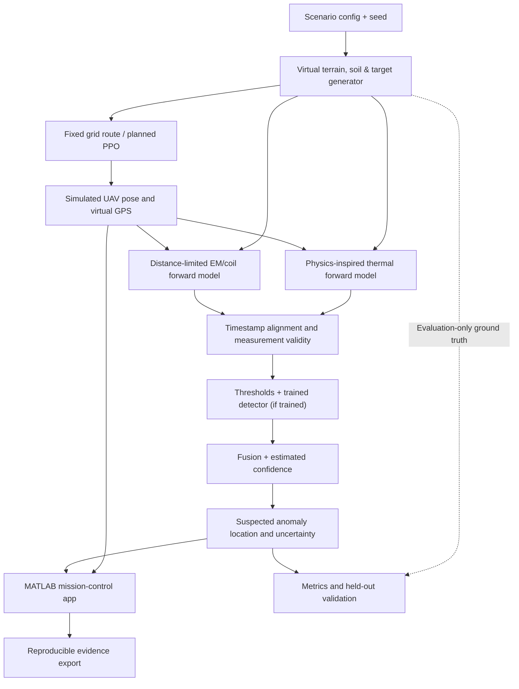
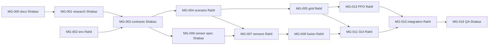
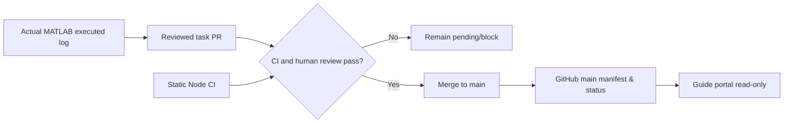
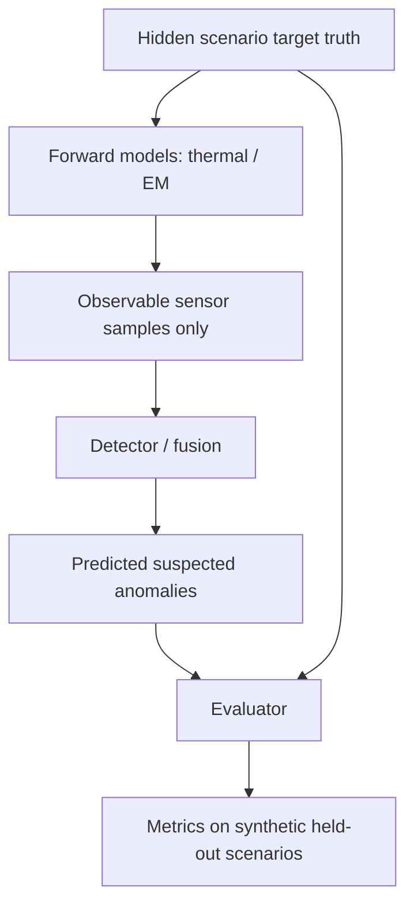

# Visual System Diagrams (Source-of-Truth Design Draft)
**All diagrams represent proposed architecture, not measured operation.** GitHub Markdown supports Mermaid on github.com.

## 1. Functional system


## 2. Two-person workflow dependencies

**Abbreviated view only:** additional edges and tasks in `tasks/manifest.json` are authoritative.

## 3. Verified status contract


## 4. Truth separation

The truth must **not** enter detector input or PPO observation/reward.

## 5. UI architecture
```text
MATLAB App Designer (research simulator):
Mission controls | 3D/2D view | Virtual telemetry | Thermal/EM sample graph
Suspected anomaly map | Confidence/uncertainty | Baseline-PPO comparison | Export

Render Static Site (academic oversight only):
Task status from main | Dependency blockers | Member ownership | Work journal
PR + CI feeds | Real evidence links | Date/deadline and no fabricated progress
```
