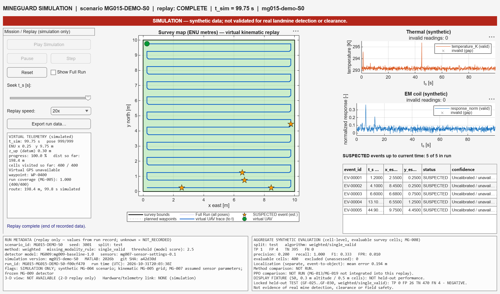
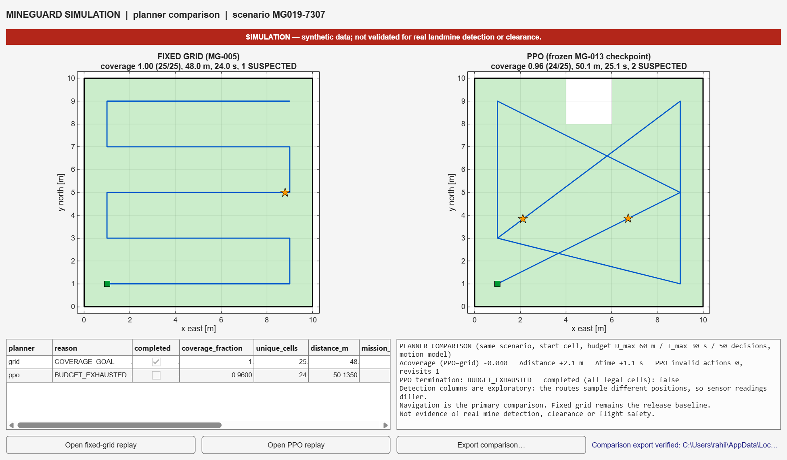

# MineGuard — Final Engineering Report
### Autonomous Aerial Landmine Detection System: MATLAB Research Simulation

**Document:** MG-018 final engineering report · **Revision:** 1.0 · **Prepared:** 2026-11-01 (IST)  
**Project repository:** https://github.com/MdShabazS/MineGuard-MATLAB  
**Scope:** Reproducible synthetic research simulation, **not** an operational mine detector  
**Release baseline:** MG-017 implementation merged via PR #44, merge commit `d37f8d8d41ab687001ec4f8515eb8fca94c2af15`; MG-017 DONE via PR #45, merge commit `8dd16ec0b83dc1bf92016dcfd72828b60a4c39c3`. Proposed tag `v1.0.0-rc.1` is **not created or authorized**.

> **Safety and scientific conclusion.** The software demonstrates a virtual autonomous survey, thermal/EM proxy sensing, suspected-anomaly processing, local virtual mapping and reproducible MATLAB replay. It **does not demonstrate accurate buried-landmine detection or real-world field safety**. The preregistered held-out weighted-fusion detector missed every positive cell: **TP 0, FP 26, TN 470, FN 4**.

## Abstract

MineGuard explores an autonomous aerial survey concept for suspected landmine-related anomalies through a deterministic MATLAB research simulation. The implementation generates synthetic survey scenes, plans a fixed serpentine grid route, creates timestamped virtual UAV poses, calculates simplified thermal and electromagnetic (EM) responses subject to standoff and noise assumptions, processes the two observation channels with frozen anomaly-detection rules and records **SUSPECTED** events. A separate evaluator uses otherwise hidden synthetic truth to compute detection metrics. A MATLAB desktop mission-replay dashboard presents virtual position, route, sensor time series and exports.

A predefined 30-family evaluation program separates 18 TRAIN, six VALIDATION and six sealed TEST families. The TEST was executed once. Among 500 assessable synthetic cells, the primary weighted method found none of the four positive cells, while generating 26 false-positive cells; an OR fusion rule reached full recall only by producing 439 false-positive cells. The simulated survey reached its coverage target, demonstrating that navigation coverage is **not** equivalent to reliable detection. A separate preregistered PPO-versus-grid evaluation found that PPO lost every one of eight grid-feasible comparisons. The release therefore keeps fixed-grid navigation as the default and explicitly labels PPO experimental. Rahil's recorded Windows 11 MATLAB R2026b clean-clone regression passed 153/153 tests. These findings support the software engineering integration but do not validate real sensors, airborne deployment or mine clearance.

**Keywords:** MATLAB, UAV simulation, serpentine grid, thermal proxy, electromagnetic proxy, sensor fusion, held-out evaluation, false positives, PPO, mission replay.

## 1. Original Phase-1 baseline (unchanged)

**Official title:** MineGuard — Autonomous Aerial Landmine Detection System.

**Original problem statement (verbatim):**
- Landmines in post-conflict areas pose a serious threat to human life and restrict land usage.
- Manual detection methods are slow, costly, and highly dangerous for personnel.
- Existing systems still require human presence in hazardous zones.
- There is a need for a safe, fast, and accurate detection system.
- An autonomous drone-based solution can detect, geo-tag, and map landmines without human risk.

**Original objectives (verbatim):**

1. To design and develop an autonomous drone system that scans suspected landmine fields by following a pre-programmed flight path without manual intervention.
2. To detect subsurface landmines accurately by integrating a metal detector coil and thermal camera with a sensor fusion algorithm that minimizes false detections.
3. To geo-tag and map every detected threat using a GPS module and display real-time detection data on a ground control station dashboard accessible from a safe distance.
4. To eliminate human exposure during landmine survey operations by replacing dangerous manual ground sweeping with a fully autonomous aerial detection system.

These are the **original intended objectives**, not a claim that all four have been achieved. The frozen primary-source transcription and its verification are in [PHASE1_BASELINE.md](PHASE1_BASELINE.md) and [SOURCE_VERIFICATION.md](SOURCE_VERIFICATION.md).

## 2. Implementation scope and design decision

The guide-directed implementation moved from an expensive physical UAV/sensor integration to a MATLAB-based synthetic experiment while preserving the original academic baseline. The implemented system is an **offline research simulation**, not a flight controller, live GCS or field deployment. The EM channel is a **normalized sensor-response proxy**, not measured metal-detector-coil hardware. Thermal responses are a **synthetic forward model in kelvin**, not images captured by a thermal camera. Virtual GPS-like positions and local East/North coordinates are not real GNSS readings.

This scope enables controlled geometry, seeded reproducibility, negative controls, missing-data handling, method comparisons and explicit failure analysis without implying operational readiness.

### 2.1 Implemented components and evidence map

| Function | Actual implementation | Main evidence |
|---|---|---|
| Scenario/hidden truth | Seeded synthetic scenario and separate truth record | MG-004 and MG-015 |
| Autonomous virtual route | Fixed-grid serpentine planner, kinematic poses, coverage | MG-005 and MG-015 |
| Sensor signals | Thermal and normalized EM proxies with validity reasons | MG-007 and MG-015 |
| Detection and scoring | Thermal, EM, OR, AND, weighted; independent evaluator | MG-009 and MG-015 |
| Mission dashboard | 2-D offline playback, virtual map, sensor traces, export | MG-011, MG-015 and MG-017 |
| Optional reinforcement learning | Trained frozen PPO survey-cell policy and fair comparison | MG-013 and MG-019 |
| Release validation | Guardrails, archive integrity, regression and clean-checkout demo | MG-016 and MG-017 |

The complete executable flow is described by `matlab/+mineguard/runExperiment.m`, `matlab/mineguardDemo.m` and the frozen API contract in [MG003_INTERFACE_FREEZE.md](MG003_INTERFACE_FREEZE.md).

## 3. System architecture

~~~text
Versioned configuration / seeded synthetic scenario
     |
     +--> Hidden target/clutter truth (restricted to physics + evaluator)
     |
     v
Fixed-grid planner --> timestamped virtual UAV poses --> virtual footprint
                                                           |
                                                +----------+----------+
                                                |                     |
                                      Thermal model (K)       EM proxy (normalized)
                                                |                     |
                                                +--- observable samples
                                                            |
                                               Frozen anomaly detector
                                            (5 methods, missing-data rules)
                                                            |
                                               SUSPECTED event records
                                                            |
                            +-------------------------------+------------------+
                            |                                                  |
                    Redacted run bundle                               Separate evaluator
                    / 2-D mission replay                       (restricted hidden truth)
                    / safe data export                          / aggregate confusion counts
~~~

**Information boundary:** the detector consumes only allowed sensor observations and poses. The synthetic truth is available to the forward models and the **separate** evaluator, not to anomaly inference, PPO observation/action selection, public mission playback or redacted exports. This is supported by source review and recorded tests; it is not a comprehensive formal security proof.

### 3.1 Autonomous virtual survey

The baseline generates a serpentine/lawnmower route through legal grid cells, respecting defined bounds and exclusions. A nominal-speed **kinematic** model samples position and time. It is not an aerodynamic, closed-loop autopilot or collision-avoidance simulation; turns are idealized. The S0 display fixture records **999 poses**, roughly **99.8 simulated seconds**, **400/400 survey cells** covered and **five SUSPECTED events**. S0 uses a special low-altitude, fine-cell display setup (0.3 m altitude, 0.5 m cells); it **must not be used as detection-performance evidence**.

### 3.2 Thermal and EM synthetic sensing

At each recorded pose, the thermal channel models ground-surface response, footprint dilution, a background level, thermal contrast, noise and possible dropout. The EM channel models a normalized response subject to stand-off loss, soil/background assumptions, noise and validity boundaries. Invalid measurements remain **NaN with a reason**, never silently become zero-valued detections. In the 5 m weak-standoff profile, the EM channel becomes `MODEL_OUT_OF_DOMAIN`. None of these values have been calibrated to an actual coil/camera/soil dataset.

### 3.3 Inference and evaluation

Thermal-only, EM-only, OR, AND and weighted fusion are compared at TRAIN-normalized, VALIDATION-selected thresholds; the prescribed primary method is **weighted / single_valid**. Anomalies are time/position associated and exported as **SUSPECTED**, not confirmed mines. Evaluation computes confusion counts with a common assessable-cell mask; **unassessable cells are excluded, not assumed safe or negative**.

## 4. Study design and reproducibility

The frozen manifest `experiments/locked/mg014_scenario_manifest.json` contains **30 distinct scenario families** allocated *before* the held-out run:

| Split | Families | Count | Allowed purpose |
|---|---|---:|---|
| TRAIN | GF-001–GF-018 | 18 | Fit normalization/background parameters |
| VALIDATION | GF-019–GF-024 | 6 | Select thresholds and predefined inference choices |
| Sealed TEST | GF-025–GF-030 | 6 | Once-only, unbiased final synthetic evaluation |

The locked TEST was executed **once on 2026-10-31 at 18:23 UTC** after recorded preflight approval; it is now consumed. `runMG015Locked("heldout", …)` refuses reopening the archive's consumed TEST, including copied run-lock and alternate output-folder attempts, before writing. This is **repository-specific accidental-reexecution protection**, not tamper-proof security. Changing the detector requires **a newly preregistered study with fresh held-out families**. Do not re-run, retune or label the consumed TEST as new evidence.

The run-lock and its approval preflight, test and stress CSVs, per-group results and detector model are in [MG-015 evidence](../tasks/evidence/MG-015.md). Exact raw values, algorithm versions and separate owner execution records are retained there.

## 5. Quantitative results

### 5.1 Metrics and denominator

For synthetic **cell-level** counts:

- **Precision** = TP / (TP + FP), when denominator is nonzero.
- **Recall / sensitivity** = TP / (TP + FN), when denominator is nonzero.
- **False-positive rate (FPR)** = FP / (FP + TN), when denominator is nonzero.
- **F1** = 2 × Precision × Recall / (Precision + Recall), under the implementation's defined zero/undefined conventions.

The preregistered `single_valid` common-mask comparison comprises **500 evaluable cells: four positive, 496 negative**. The sixth TEST family GF-030 has **zero evaluable cells** in the common five-method mask, due to out-of-domain EM at 5 m. It must not be described as a successful detection test.

### 5.2 Held-out TEST: the central finding

| Detector method | TP | FP | TN | FN | Precision | Recall | FPR |
|---|---:|---:|---:|---:|---:|---:|---:|
| **Weighted fusion (primary)** | **0** | **26** | **470** | **4** | **0.000** | **0.000** | **0.0524** |
| Thermal-only | 3 | 179 | 317 | 1 | 0.0165 | 0.750 | 0.3609 |
| EM-only | 0 | 116 | 380 | 4 | 0.000 | 0.000 | 0.2339 |
| OR fusion | 4 | 439 | 57 | 0 | 0.0090 | 1.000 | 0.8851 |
| AND fusion | 0 | 16 | 480 | 4 | 0.000 | 0.000 | 0.0323 |

Source: [independent arithmetic audit, MG-016](../tasks/evidence/MG-016.md) reconciled the **15** summary method/rule rows, **90** group rows and metric equations in committed evidence.

**Interpretation:** The primary detector missed all four positive cells; its 26 false-positive cells are not evidence of detection. The OR method alarms in most negative cells to achieve 100% recall: its precision is approximately **0.9%**. Consequently, **none of the frozen methods is useful at the evaluated synthetic settings**. This is a narrow model-dependent result from a very small positive population, not a population-level estimate of real sensors.

**S0 demonstration is not this test.** The visually attractive S0 fixture yields TP 1 / FP 4 / TN 395 / FN 0 and 100% grid coverage. S0 was built for showing the UI, not estimating held-out performance. Display the negative held-out row next to it in the presentation.

### 5.3 Stress conditions and failure modes

Five preregistered stress conditions were evaluated separately: `noise_x3`, `dropout_0p3`, `negative_contrast`, `soil_shift` and `em_rate_half`. The weighted method under triple noise generated **466 FP / 496 negative cells (FPR ≈ 0.940)**; under shifted soil/background it generated **496/496 FP (FPR = 1.000)**. A dropout scenario recorded about **0.3634 invalid-sample fraction**. These are separate analyses, **not** additional held-out cells to add to the 500-cell denominator.

Likely contributors documented in the experiment: a small thermal footprint signal diluted by survey geometry, weak/invalid EM response at stand-off, noise/clutter variability, and the preregistered tie-breaking rule selecting permissive validation thresholds.

### 5.4 PPO survey-policy comparison (optional experimental feature)

The frozen PPO agent operates on a **5×5 / 25-action** survey environment, and its comparison has a separate preregistered seed manifest. It is not the 10×10 locked GF detection TEST.

| Navigation measure | Fixed-grid baseline | PPO | Interpretation |
|---|---:|---:|---|
| Matched, grid-feasible scenarios | 8 | 8 | Valid paired comparison |
| Mean coverage | 1.000 | 0.938 | PPO − grid = **−0.062** |
| Mean distance difference | — | +3.15 m | PPO travelled farther |
| Wins on comparable scenarios | **8** | **0** | PPO lost every feasible pair |
| PPO mission completions, entire 20-case evaluation | — | **0/20** | All PPO cases incomplete |

The reported 95% bootstrap interval for paired Δcoverage was **[−0.107, −0.040]**. Of 20 PPO evaluation scenarios, **12 lacked a feasible grid route** due to the grid planner's exclusion-zone limitation; these are *not* PPO wins and cannot be included in the paired eight. Frozen benchmark, seed provenance and details: [MG-019 evidence](../tasks/evidence/MG-019.md). **Decision:** keep the fixed-grid planner as release default, PPO labelled **EXPERIMENTAL**; do not claim a superior learning planner or a detection gain.

## 6. Software verification, platform and reproducibility

The current release-candidate engineering proof includes a clean Windows 11 Pro / MATLAB **R2026b Update 1** clone, actual dashboard play/pause/step/seek/reset, verified seven-file export readback, PPO demo matching the frozen benchmark row and **153/153 passing MATLAB tests** (9 suites; 0 failed, 0 incomplete, as reported by Rahil). Code was exercised at `f65af49d6366f8854aac75a3dc41c25368302be4` and final evidence committed at `01520190d04485ad5b4da0a48bd475cdcc9e05e9`; see [MG-017 evidence](../tasks/evidence/MG-017.md). That test count is **owner-recorded**, not independently rerun by this MG-018 document author.

- The **core fixed-grid demo** uses base MATLAB and a graphical MATLAB desktop.
- Optional **PPO** requires Reinforcement Learning Toolbox and Deep Learning Toolbox.
- **GitHub Task Gate and browser QA do not execute MATLAB.** They validate repository governance and the guide portal.
- macOS/Linux and other MATLAB versions do not have equivalent **committed release-level test records**; an individual MacBook S0 launch is not a substitute for the full cross-platform regression.
- The release candidate remains **untagged**, pending a separate explicit authorization. This report does not grant that authorization.

### 6.1 Safe reproduction, from repo root in MATLAB

~~~matlab
addpath('matlab');
mineguardDemo                       % S0 fixture; explicitly NOT held-out results
mineguardDemo("GF-020")           % optional VALIDATION-family demonstration
~~~

For a full recorded Windows test suite in a suitable licensed desktop environment, use the tests and environment in [MG-017 evidence](../tasks/evidence/MG-017.md); do not imply those suites ran on another machine. The PPO demo is **optional** and only where its toolbox dependencies are installed:

~~~matlab
mineguardPPODemo(7307)             % experimental comparison; frozen checkpoint
~~~

**Never invoke `runMG015Locked("heldout",…)` in a live demo.** Never regenerate the sealed TEST. For exports, use the dashboard's export control: `poses.csv`, `thermal_samples.csv`, `em_samples.csv`, `events.csv`, `summary.json`, `run_bundle_redacted.mat` and `snapshot.png`. The allowlisted export omits private synthetic truth labels, buried-target attributes and coordinates. Exported anomaly rows remain `SUSPECTED`.

### 6.2 Guide-ready recorded figures

*Figure 1. Archival MATLAB R2026b screenshot of the completed **S0 display fixture**. The route/map and sensor graphs are synthetic. This is not the held-out TEST and not a real mine-detection result.*

*Figure 2. Archival R2026b comparison from PPO scenario 7307, which shows grid coverage 1.000 versus PPO 0.960. PPO's scientifically valid summary is the full preregistered feasible-pair evaluation, not just this selected display case.*

- [S0 ready dashboard](../tasks/evidence/MG-017/MG-017-01-demo-S0-ready.png)
- [S0 seek to 50 seconds](../tasks/evidence/MG-017/MG-017-02-demo-S0-seek-50s.png)
- [S0 complete replay](../tasks/evidence/MG-017/MG-017-03-demo-S0-complete.png)
- [PPO versus fixed-grid comparison UI](../tasks/evidence/MG-017/MG-017-04-ppo-comparison-7307.png)
- [Clean-checkout console transcript](../tasks/evidence/MG-017/clean-checkout-console.txt)
- [153/153 clean-clone regression summary](../tasks/evidence/MG-017/regression-clean-clone-f65af49.txt)

These are Rahil's archived evidence artifacts; do not misrepresent them as field imagery, external mine-detection footage, or newly recorded MG-018 tests.

## 7. Original objective traceability and actual outcome

| Original objective | What is supported by recorded simulation evidence | What is **not achieved or validated** |
|---|---|---|
| **O1** preprogrammed autonomous flight path | Kinematic virtual UAV follows fixed-grid survey and covers legal cells | Real autonomous UAV, real flight dynamics and safety-certified navigation |
| **O2** accurate subsurface detection, coil + thermal, fusion reducing false alarms | Synthetic thermal/EM proxy fusion and independent scoring execute | **Accuracy goal not achieved**; locked TP 0/4 positive; no field detection |
| **O3** geo-tag/map threats and real-time remote GCS | Local virtual coordinates, event map, MATLAB **offline replay** and export | Physical GNSS, live drone telemetry, true remote field GCS |
| **O4** remove human exposure | Unattended **virtual** route illustrates proposed workflow | No measured risk reduction, real-world mine clearance or safety proof |

**Engineering conclusion:** The team completed a controlled **simulation and measurement pipeline** and learned that its frozen sensing configuration is not dependable for the intended task. Recording this negative result is academically stronger than hiding false alarms or relabeling coverage as detection accuracy.

## 8. Limitations and risk register

| Risk / gap | Current impact | Mitigation or future experiment |
|---|---|---|
| Synthetic-to-field domain gap | Thermal/EM outputs do not demonstrate sensor accuracy | Calibrate using permitted physical measurements and independent real-world controls |
| Weak standoff physics | 5 m EM profile invalid; 2 m signals near noise | Measure coil/camera geometry and sensitivity before a new preregistered study |
| Very few positive assessable cells | Wide uncertainty; fragile recall claims | Expand **new**, independently held-out synthetic/physical populations |
| High false alarms | Operational use would create unacceptable burden | Fresh study with revised hypotheses/thresholds; never retune consumed TEST |
| Ideal kinematics | Unrealistic turn/energy/obstacle behavior | Separately validate 3-D dynamics and bounded/autopilot interfaces |
| PPO underperformance | Not suitable as default | More appropriate actions, training design and preregistered replication |
| No physical GCS/sensors | No field telemetry or clearance claim possible | Bench and field validation with appropriate approvals and safety controls |
| Cross-platform execution coverage | Mac/Linux full regression not archived | Separate release test matrix for each host and required toolbox |
| Provenance nuance | MG-019 runSurveyMission lacks dirty-tree marker | Improve code provenance in future release; retain known recorded commit-equivalence caveat |

**Not implemented in this release:** 3-D replay, live UAV feed, physical GPS/flight-controller/Raspberry Pi integration, physical thermal/RGB/LiDAR sensors, or measured mine detection. A 2-D offline playback is **not** a 3-D digital twin. A guide portal is a repository/status visualization, **not** a physical mission ground station.

## 9. Conclusions and forward roadmap

1. **Achieved in simulation:** seeded scenarios, fixed-route survey, virtual positions, sensor-forward-model evaluation, anomaly fusion, truth-separated scoring, MATLAB playback/export and reproducible Windows test evidence.
2. **Not achieved scientifically:** accurate synthetic mine-like target detection in the frozen held-out conditions. Primary TP = 0 and FN = 4; the most sensitive comparator suffers 439 false positives.
3. **Not demonstrated physically:** UAV autonomy, buried-mine sensing, GNSS/live field GCS or personnel-risk reduction.
4. **Navigation comparison:** frozen PPO implementation was genuinely tested, but the fixed grid was better on all comparable scenarios; use the fixed grid by default.
5. **Future work:** (a) new, preregistered sensing study with calibration/valid stand-off and fresh holdout; (b) 3-D and more realistic drone dynamics; (c) host/toolbox portability matrix; (d) optional RGB/LiDAR and real-hardware design only after separate technical and safety validation.

The presentation must not claim that a high coverage percentage is detection accuracy, that the current display finds buried mines, that PPO wins, or that the ground is safe. The valid project contribution is a **reproducible, candid engineering simulation with measured failure modes**.

## 10. Evidence and bibliographic boundary

**Primary project artifacts:** [PHASE1_BASELINE](PHASE1_BASELINE.md), [SOURCE_VERIFICATION](SOURCE_VERIFICATION.md), [frozen interfaces](MG003_INTERFACE_FREEZE.md), [MG-014 preregistration](MG014_LOCKED_TEST_MATRIX_AND_DEMO.md), [MG-015 experiment](../tasks/evidence/MG-015.md), [MG-016 audit](../tasks/evidence/MG-016.md), [MG-017 release validation](../tasks/evidence/MG-017.md), [MG-019 PPO evaluation](../tasks/evidence/MG-019.md), [RELEASE_NOTES](RELEASE_NOTES_v1.0.0-rc.1.md), and [LITERATURE_REVIEW](LITERATURE_REVIEW.md) for externally sourced scientific background. Method/results above are **internal synthetic-study findings**, not independently published empirical detection evidence.

### Selected external scientific context

These references are carried forward from the repository's [verified literature review](LITERATURE_REVIEW.md) for physical-feasibility context. Their results **are not MineGuard experiment results**; bibliographic author names are omitted where not independently established in the internal record.

1. “Detection of anti-personnel mines of the ‘leg breakers’ type by analyzing thermographic images captured from a drone at different heights,” *Infrared Physics & Technology*, vol. 142, article 105567 (2024). DOI: https://doi.org/10.1016/j.infrared.2024.105567.
2. “Study on the temperature field and infrared characteristics of unsaturated soils with shallow buried objects at different depths,” *International Journal of Thermal Sciences*, article 109282 (2024). DOI: https://doi.org/10.1016/j.ijthermalsci.2024.109282.
3. “Detection of ‘Legbreaker’ Antipersonnel Landmines by Analysis of Aerial Thermographic Images of the Soil,” *Engineering Proceedings*, 8(1), article 25 (2021). Publisher: https://www.mdpi.com/2673-4591/8/1/25.
4. “A Comparative Evaluation of UAV-Based Remote Sensing and Geophysical Techniques for Landmine Detection on a Seeded Minefield,” *Remote Sensing*, 18(13), article 2182 (2026). Publisher: https://www.mdpi.com/2072-4292/18/13/2182.

**Presentation companion:** [FINAL_DEMO_SCRIPT.md](FINAL_DEMO_SCRIPT.md). **Reviewer acceptance and open limitations:** [MG-018 evidence](../tasks/evidence/MG-018.md).
